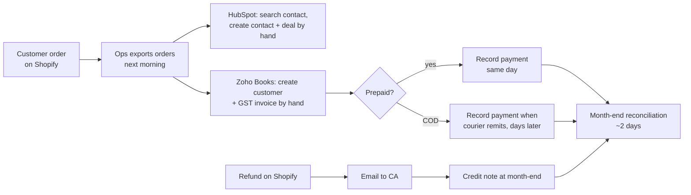

# 01 — Discovery

> **Simulated engagement.** "Glow & Grace" is a fictional Indian D2C skincare brand. Stakeholders, interview answers, volumes and baselines in this document are **simulated** and marked **(S)**. Facts about the systems come from the Phase 0 connectivity checks ([setup guide](00-setup-guide.md)). Legal points are cited and marked **to verify** where they need a tax professional's confirmation.

| | |
|---|---|
| **Client** | Glow & Grace (fictional) |
| **Phase** | 1 — Discovery |
| **Date** | November 2026 |
| **Method** | Simulated stakeholder interviews (questionnaire in [Appendix A](#appendix-a--discovery-questionnaire)) + live API checks of all four systems |
| **Status** | Approved (simulated client sign-off, 13 Nov 2026) |

---

## 1. Summary

Glow & Grace sells skincare on its own Shopify store and ships across India. Every order is re-typed by hand into Zoho Books (to raise a GST invoice) and into HubSpot (to keep a customer record). This takes about **3.3 hours a day (S)**, produces wrong GST splits on about **3% of invoices (S)**, and leaves invoices **1–3 days late (S)**.

Discovery found three things that shape the design:

1. **Invoice timing differs for prepaid and cash-on-delivery (COD) orders.** For goods, GST law requires the tax invoice by the time the goods are dispatched, not when the customer pays. COD orders are paid only on delivery, so "order paid" cannot be the only trigger. ([§6.2](#62-payment-methods-and-invoice-timing))
2. **Make's free plan cannot carry production volume.** About 1,200 orders a month (S) against 1,000 credits a month means the Make build is a working demonstration; the Python service is the production path. ([§7](#7-volumes-and-capacity-check))
3. **Shopify prices include GST.** Zoho Books must back-calculate the tax from the price, and the split (CGST+SGST or IGST) depends on the delivery state. ([§6.1](#61-gst-split-by-delivery-state))

---

## 2. Stakeholders (S)

| Role | Involvement | What they care about |
|---|---|---|
| Founder & CEO | Sponsor; approves scope and budget | Fewer manual hours, no compliance risk, clean numbers for investors |
| Operations Executive | Does the re-typing today; main user of alerts | Not typing orders; knowing quickly when something fails, and how to fix it |
| External Chartered Accountant (CA) | Files GST returns from Zoho Books | Correct GST split, invoice numbering, credit notes that match refunds |
| Marketing & CRM Lead | Owns HubSpot | One contact per customer; order history on the contact for campaigns |

---

## 3. Current process (as-is) (S)

1. A customer places an order on Shopify (prepaid via the payment gateway, or COD).
2. Next working morning, the Operations Executive exports or opens the day's orders.
3. For each order, they search HubSpot for the customer, create a contact if not found (often creating a duplicate), and create a deal.
4. They search Zoho Books for the customer, create one if needed, then create an invoice: line items, prices, and they pick the GST rate and split by hand from the delivery address.
5. For prepaid orders they record the payment in Zoho Books. For COD orders they record it days later, when the courier remits the cash.
6. Refunds and returns are emailed to the CA, who raises credit notes during month-end.
7. At month-end, the CA and Operations spend about 2 days matching Shopify payouts, Zoho invoices and refunds.

---

## 4. Pain points and baselines

The baselines below are simulated so that the project can report a before/after in Phase 8.

| # | Pain point | Baseline (S) | Who feels it |
|---|---|---|---|
| P1 | Manual re-typing into two systems | ~5 min per order → ~3.3 h/day at 40 orders | Operations |
| P2 | Wrong GST split (CGST+SGST vs IGST) or rate | ~3% of invoices need correction | CA |
| P3 | Duplicate customers | ~8% of HubSpot contacts are duplicates | Marketing |
| P4 | Late invoices | Raised 1–3 days after the order | CA, Founder |
| P5 | Failures are invisible | Missed orders found only at month-end | Operations, CA |
| P6 | Refunds not reflected | Credit notes raised up to 30 days late | CA |
| P7 | Slow reconciliation | ~2 working days per month | CA, Operations |

---

## 5. Systems inventory

Facts in this table were confirmed by live API calls on 13 Nov 2026 (`scripts/check_connectivity.py`), except where marked.

| System | Role | Plan / edition | API access | Limits relevant to design |
|---|---|---|---|---|
| Shopify | Source of orders, customers, refunds | Development store, currency INR | Dev Dashboard app, client credentials grant (24-hour token), GraphQL Admin API `2026-10`, read-only scopes | Webhooks signed with the app's client secret (HMAC). Customer fields are *protected customer data*. |
| HubSpot | CRM: contacts and deals | Free CRM | Service key (Bearer token) | 100 requests / 10 s; 250,000 / day ([setup guide, Step 3](00-setup-guide.md#step-3--hubspot-free-crm-and-service-key-20-min)) |
| Zoho Books | Accounting: customers, GST invoices, payments, credit notes | India edition, India data centre (`.in`) | Self Client OAuth; 1-hour access token from a refresh token | API rate limits and free-plan document limits **not yet checked** (Phase 3) |
| Make | No-code integration layer | Free | — | 1,000 credits / month. Active-scenario limit and minimum interval: confirm in Phase 4 |
| ngrok | Public HTTPS URL for local webhooks (development only) | Free | Authtoken | Agent version ≥ 3.29.0 required |

---

## 6. Business rules gathered (S)

### 6.1 GST split by delivery state

- **Seller location (S):** Glow & Grace is registered in **Haryana**.
- **Rule:** delivery within Haryana is an intra-state supply → **CGST + SGST** (half each). Delivery to any other state is inter-state → **IGST**. For goods that are shipped, the place of supply is where the delivery ends, which for our orders is the shipping address. *Basis:* IGST Act 2017, sections 7, 8 and 10(1)(a) ([CBIC GST portal](https://cbic-gst.gov.in/)). **To verify** with the CA in Phase 3.
- **Prices (S):** Shopify prices are **GST-inclusive** (the price the customer sees is the final price). Zoho Books invoices must use tax-inclusive line amounts, so the GST is calculated *inside* the price.
- **Rates and HSN codes:** decided in Phase 3 from official sources. Not assumed here.
- **Shipping charge (S):** free above ₹499; ₹49 below. How GST applies to a shipping charge on the same invoice is **to verify** in Phase 3.

### 6.2 Payment methods and invoice timing

- **Mix (S):** 65% prepaid (UPI and cards through Shopify's payment gateway), 35% COD.
- **Rule:** for a supply of goods involving movement, the tax invoice must be issued **before or at the time of removal** (dispatch) of the goods. *Basis:* CGST Act 2017, section 31(1). **To verify** with the CA in Phase 3.
- **Proposed triggers (S):**
  - *Prepaid:* create the invoice when Shopify marks the order **paid**, and record the payment straight away. Issuing before dispatch is allowed.
  - *COD:* create the invoice when the order is **fulfilled** (dispatched). Record the payment when Shopify marks it paid after delivery.
  - *COD returned undelivered (RTO, ~15% of COD orders) (S):* raise a credit note against the invoice.
  - *Prepaid order cancelled before dispatch:* raise a credit note and record the refund.

### 6.3 Customer identity

- **Match key (S):** customer **email**, which the store requires at checkout. The same email must not create a second contact in HubSpot or a second customer in Zoho Books.
- **Existing duplicates (S):** cleaning the ~8% existing HubSpot duplicates is out of scope; the integration only stops new ones.

### 6.4 Refunds and returns

- **Rate (S):** ~5% of delivered orders are refunded. 70% are full refunds, 30% partial (one item, or a goodwill amount).
- **Rule (S):** each Shopify refund creates one Zoho Books credit note for the refunded amount and updates the HubSpot deal.

### 6.5 Customer type

- **B2C only in v1 (S).** About 2% of orders come from salons wanting a GST invoice with their GSTIN. Shopify's standard checkout doesn't collect a GSTIN, so these stay manual in v1.

---

## 7. Volumes and capacity check

| Measure | Value (S) |
|---|---|
| Average orders per day | 40 |
| Peak orders per day (sale days, ~6 a year) | 200 |
| Orders per month | ~1,200 |
| Average order value | ₹1,150 |
| Annual revenue (derived) | ~₹1.66 crore |
| Orders delivered within Haryana | 22% (CGST+SGST); the other 78% IGST |

**Checked against real limits:**

- **HubSpot:** a few API calls per order (find contact, create or update it, create deal, link them). At 200 orders on a peak day that's on the order of 1,000 calls, far below 250,000 a day. The 100-per-10-seconds limit matters only for bulk backfills, which will need throttling.
- **Make (free):** 1,200 orders a month already exceeds 1,000 credits a month even if each order used just one credit, and a real scenario runs several modules per order. **Decision (S):** the Make build runs on test orders as a demonstration; the FastAPI service is the production path. The exact credits per order will be measured in Phase 4.
- **Zoho Books:** API and free-plan limits are not yet checked. About 14,400 invoices a year (S) must be checked against them in Phase 3.

---

## 8. Success measures

Each target maps to a pain point in §4. Targets are simulated (S).

| Pain point | Measure | Target (S) |
|---|---|---|
| P1 | Manual effort | < 30 min/day, exceptions only |
| P2 | Invoices needing GST correction | 0% for B2C orders |
| P3 | New duplicate customers | 0 in HubSpot and Zoho Books |
| P4 | Invoice delay | Within 15 minutes of the trigger in §6.2 |
| P5 | Failed records | Alert within 5 minutes; each failure listed and re-processable |
| P6 | Credit note delay | Within 15 minutes of the Shopify refund |
| P7 | Month-end reconciliation | < 2 hours, using the reconciliation script (Phase 5) |
| — | Duplicate invoices | Never more than one invoice per order (idempotency) |

---

## 9. Scope

| In scope (v1) | Stretch | Out of scope |
|---|---|---|
| Flow 1: order → HubSpot contact + deal → Zoho customer → GST invoice → payment | Flow 3: website lead → HubSpot deal → Zoho customer | Inventory and stock sync |
| Flow 2: refund / RTO / cancellation → credit note → HubSpot deal update | | Courier and shipping integration |
| Alerts and a failed-records list with re-processing | | GST return filing (GSTR-1/3B) — stays with the CA |
| Reconciliation script (Shopify vs Zoho Books) | | B2B invoices with buyer GSTIN (§6.5) |
| | | E-invoicing (IRN); simulated turnover is below the threshold and B2C invoices are excluded — **to verify** in Phase 3 |
| | | Cleaning existing duplicate contacts |

---

## 10. Assumptions register

These are the simulated decisions this document depends on. **All approved on 13 Nov 2026** (A1 changed from Maharashtra to Haryana at review). Phase 2 builds on them.

| ID | Assumption (S) | Used in |
|---|---|---|
| A1 | Seller is GST-registered in Haryana | GST split (Phase 3) |
| A2 | Shopify prices are GST-inclusive | Invoice line amounts (Phase 3) |
| A3 | Payment mix: 65% prepaid, 35% COD | Trigger design, test data |
| A4 | Prepaid orders invoiced on **paid**; COD orders invoiced on **fulfilled** | Flow 1 triggers (Phase 2) |
| A5 | RTO ~15% of COD orders, each needs a credit note | Flow 2 (Phase 2) |
| A6 | Email is the unique customer key and is required at checkout | De-duplication (Phase 3) |
| A7 | ~5% of orders refunded; 70% full / 30% partial | Flow 2, test data |
| A8 | B2C only in v1; GSTIN invoices stay manual | Scope |
| A9 | Volumes: 40/day average, 200/day peak, AOV ₹1,150 | Capacity, retry design |
| A10 | 22% of orders delivered within Haryana | Test data mix |
| A11 | Shipping: free above ₹499, else ₹49 | Invoice lines (Phase 3) |
| A12 | Make build is a demonstration; FastAPI service is production | Architecture (Phase 3) |
| A13 | Baselines and targets in §4 and §8 | Phase 8 before/after |

---

## 11. Open questions and risks

| # | Item | Type | Resolve in |
|---|---|---|---|
| Q1 | Does linking a HubSpot deal to a contact need an extra scope? | Question | Phase 3 |
| Q2 | Make free plan: active-scenario limit and minimum schedule interval | Question | Phase 4 |
| Q3 | Zoho Books API rate limits and free-plan document limits vs ~14,400 invoices/year | Risk | Phase 3 |
| Q4 | GST points marked *to verify*: invoice timing (§6.2), shipping charge, e-invoicing threshold | Risk (compliance) | Phase 3, with CA |
| Q5 | Rounding: back-calculated GST may differ from Shopify's totals by paise | Risk | Phase 3 |
| Q6 | Shopify protected customer data: fine on a dev store; a live store needs Shopify's review | Risk | Phase 7 (security) |
| Q7 | README Flow 1 trigger says "order paid"; A4 changes it for COD | Doc update | Phase 2 |

---

## Appendix A — Discovery questionnaire

Questions used in the (simulated) interviews. Reusable for a real engagement.

**Founder & CEO**
1. What would make this project a success in three months?
2. What is the budget for tools (Make, Zoho Books plan, hosting)?
3. Which risks worry you most: compliance, cost, or customer experience?

**Operations Executive**
1. Walk me through yesterday's orders, step by step, in each system.
2. Which step takes longest? Which goes wrong most often?
3. How do you find out an order was missed?
4. How do COD orders, cancellations and returns differ?

**Chartered Accountant**
1. Where is the business GST-registered, and in which states?
2. When do you expect the invoice to be raised: at order, dispatch, or payment?
3. How are refunds, partial refunds and undelivered COD orders handled?
4. What invoice numbering series do you use? Any B2B invoices with GSTIN?
5. What does month-end reconciliation involve today?

**Marketing & CRM Lead**
1. What identifies a unique customer for you?
2. Which order details do you need on the HubSpot contact or deal?
3. How many duplicates exist today, and how do they appear?

**Systems (all)**
1. Which plans are you on, and are upgrades possible?
2. Who owns each system's admin access?
3. Are there other tools touching orders (courier, payment gateway, spreadsheets)?
